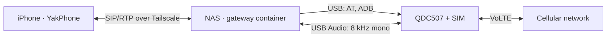

<div align="center">

# CBD

**Turn a QDC507 4G module and a SIM card into an always-on second line for your
iPhone, hosted on your NAS: VoLTE calls, SMS, and lock-screen incoming calls.**

[![Go][go-shield]][go-url]
[![Docker][docker-shield]][docker-url]
[![License][license-shield]][license-url]

[简体中文](README.md) · [English](README.en.md)

[Report a bug](https://github.com/FanBB2333/CBD/issues/new?labels=bug) ·
[Request a feature](https://github.com/FanBB2333/CBD/issues/new?labels=enhancement)

</div>

> [!IMPORTANT]
> CBD has been tested end to end on a single QNAP NAS, and several scenarios
> are still untested (see [Limitations](#limitations)). Don't rely on it for your
> primary number yet. The module-side voice runtime is closed-source vendor
> firmware and is not distributed with this repository.

## Table of contents

1. [About the project](#about-the-project)
2. [Getting started](#getting-started)
3. [Usage](#usage)
4. [Documentation](#documentation)
5. [Development](#development)
6. [Limitations](#limitations)
7. [Contributing](#contributing)
8. [License](#license)
9. [Acknowledgments](#acknowledgments)

## About the project

CBD (CellBridge-Docker) is derived from
[CellBridge](https://github.com/mccding/CellBridge). The SIM card sits in a
QDC507 module, which connects to a NAS over USB. A gateway container on the NAS
acts as a SIP server; once YakPhone on the iPhone registers through Tailscale,
you can make calls and send texts with that SIM.



### What you can do

- **Make and answer calls.** Calls dialed in YakPhone go out over VoLTE through
  the module. Incoming calls ring on the phone, and PushKit wakes it when it is
  locked.
- **Send and receive SMS**, including Chinese text, multipart messages, and
  carrier short codes. Messages that arrive while the phone is offline stay on
  the NAS and are delivered when it reconnects.
- **Keep records.** Call history and messages are stored in SQLite.
- **Run it on the NAS full time.** No Mac has to stay on, and the host does not
  need a serial driver.

### Differences from CellBridge

| | CellBridge | CBD |
|---|---|---|
| Deployment | Bare-metal fnOS + systemd | Docker container, unprivileged (`cap_drop: ALL`) |
| AT serial port | Needs a host `ttyUSB` driver | libusb→PTY bridge inside the container; no host driver needed |
| Module setup | Script changes the VID/PID | Read-only by default; only enables ADB/UAC, after backing up the original values |
| SIP authentication | Placeholder (only checks that an `Authorization` header is present) | Full Digest authentication with replay protection |
| Call control | ACK not handled; cancelling while ringing is blocked | Full INVITE transactions; cancel takes effect at once; hangup confirmed with CLCC |
| Proxies and NAT | RTP always sent to the SDP port | Learns the actual RTP port, so calls work with Surge or similar proxies on the phone |
| Uplink latency | About 1 s of playback buffer | 80 ms ring buffer; 21–41 ms measured at the sound card |
| Back-to-back calls | The call after a cancelled one can be silent | Audio route rebuilt for every call |
| SMS | SIP retransmissions can send a message twice | Persistent deduplication; multipart recovery; offline catch-up |
| Lock-screen calls | Token-only push format | YakPhone Pro token callback; no duplicate push once the phone is already ringing |

### Built with

- [Go](https://go.dev/) 1.25 for the gateway, SIP/RTP, and the SMS engine
- [PyUSB](https://github.com/pyusb/pyusb) and [libusb](https://libusb.info/) for the USB AT bridge
- [SQLite](https://www.sqlite.org/) ([modernc.org/sqlite](https://pkg.go.dev/modernc.org/sqlite)) for calls and messages
- [Docker](https://www.docker.com/) Compose and [Tailscale](https://tailscale.com/)

## Getting started

You need:

- A QDC507 module (first-generation DJI 4G module, USB ID `2ca3:4006` or `2c7c:0125`)
- A SIM card with VoLTE enabled
- A Linux NAS with a USB port that can run Docker (tested on QNAP QTS 5.2,
  x86_64)
- The NAS and the iPhone on the same Tailscale tailnet
- [YakPhone](https://apps.apple.com/app/id6763033863) on the iPhone; lock-screen
  calls need YakPhone Pro

The commands below use QNAP as the example and run on the NAS. On QNAP,
`docker` lives in the Container Station directory:

```sh
cs_path=$(getcfg container-station Install_Path -f /etc/config/qpkg.conf)
export PATH="$cs_path/bin:$PATH"
git clone https://github.com/FanBB2333/CBD.git && cd CBD
```

1. **Check the host** (read-only). Confirm that Docker, the module's USB device,
   and its USB sound card are detected.

   ```sh
   sh scripts/qnap-preflight.sh
   ```

2. **Set up the module.** Enable the module's ADB and USB Audio (UAC).
   `gateway/tools/init_usb.py` is read-only unless you pass
   `--apply --backup <file>`, which writes the change and restarts the module.
   The steps and the rollback procedure are in the
   [deployment guide](docs/deployment/qnap.md) (Chinese).

3. **Download the module voice runtime.** The files are checked against pinned
   SHA-256 hashes and are not built into the image.

   ```sh
   mkdir -p /share/Container/cbd/data
   python3 scripts/fetch-voice-runtime.py --dest /share/Container/cbd/module-voice
   ```

4. **Build the image.** To use mirrors, pass build args such as `GO_IMAGE`,
   `GOPROXY`, and `DEBIAN_MIRROR`; see
   [`.env.qnap.example`](infra/docker/.env.qnap.example).

   ```sh
   docker build --platform linux/amd64 -f gateway/Dockerfile -t cellbridge-gateway:qnap .
   ```

5. **Write the configuration.** Copy
   [`config.qnap.example.yaml`](infra/config.qnap.example.yaml) and change these
   fields:

   ```sh
   cp infra/config.qnap.example.yaml /share/Container/cbd/config.yaml
   ```

   ```yaml
   modem:
     usb_path: 1-2                  # physical USB port of the module
   voice:
     enabled: true                  # enable after the module setup passes
     bootstrap: true
     rx_path: hw:CARD=Baiwang,DEV=0
     tx_path: hw:CARD=Baiwang,DEV=0
   sip:
     enabled: true
     listen: 100.x.y.z:5060         # the NAS's Tailscale address
     users:
       - username: iphone
         password: <random password>
   ```

6. **Start the gateway.**

   ```sh
   cp infra/docker/.env.qnap.example infra/docker/.env   # fill in absolute paths on the NAS
   docker compose --env-file infra/docker/.env -f infra/docker/docker-compose.qnap.yml config --quiet
   docker compose --env-file infra/docker/.env -f infra/docker/docker-compose.qnap.yml up -d --no-build
   curl -fsS http://127.0.0.1:8787/api/v1/health
   ```

   The health endpoint only shows that the process is running. Whether the
   module and voice path are ready is confirmed by the phone registering and
   completing a call.

## Usage

### Connect YakPhone

| Setting | Value |
|---|---|
| Server | `<NAS Tailscale address or MagicDNS name>:5060` |
| Transport | UDP |
| Username / password | From `sip.users` |
| Codec | PCMU first |
| STUN / TURN | Off |

Once registered, you can dial. To send a text, enter the full number in
YakPhone's messages view.

### Enable lock-screen calls

This needs YakPhone Pro.

1. Set `sip.push_callback_listen: 127.0.0.1:8788` and restart the container.
   The gateway creates `data/yakphone-push.json` (mode 0600), which holds the
   `callback_key`.
2. Use Tailscale Serve to forward HTTPS port 8443 to the callback port. It is
   reachable only inside the tailnet; don't enable Funnel.

   ```sh
   tailscale serve https:8443 / http://127.0.0.1:8788   # Tailscale 1.40 syntax
   ```

3. In YakPhone, set the token callback URL to
   `https://<NAS ts.net hostname>:8443/token/<callback_key>`.

If the phone is already ringing through SIP, the gateway skips the push so the
same call doesn't ring twice.

### Enable SMS

A fresh deployment does not read incoming messages, and sending is a dry run.
When you are ready:

- set `sms.inbox_enabled: true` in the configuration;
- set `CELLBRIDGE_SMS_DRY_RUN=false` in `.env`.

With dry run off, messages are submitted to the carrier and billed.

### Other Linux hosts

If the host already has a `ttyUSB` serial driver (fnOS, for example), set
`modem.transport: serial` and follow the
[upstream tutorial](docs/CellBridge.en.md).

## Documentation

- [QNAP deployment guide and test log](docs/deployment/qnap.md) (Chinese):
  module setup, container permissions, fixes, and test results
- [Full CellBridge tutorial](docs/CellBridge.en.md): the upstream serial
  deployment, eight-layer troubleshooting method, and known pitfalls
  ([Chinese](docs/CellBridge.md))
- [Operations and administration](docs/operations/admin.md)
- [Architecture decision records](docs/architecture/)
- [Third-party notices](ThirdParty/ThirdPartyNotices.md)

## Development

```sh
cd gateway
go test ./...
go test -race ./internal/config ./internal/modem/... ./internal/sip ./internal/voice/...
go vet ./...
cd ..
python3 -m unittest discover -s gateway/tools -p 'test_*.py'
```

The automated tests use a simulated module, AT port, and UDP peers. They never
place calls or send SMS.

## Limitations

- Only the QDC507 is supported, with one SIM and one call at a time.
- Tested on QNAP: foreground registration, two-way audio on incoming and
  outgoing calls, cancelling while ringing, answering from the lock screen via
  push, receiving SMS, and recovery after a container restart.
- Not yet tested: sending SMS for real on QNAP, calls longer than 60 seconds,
  several back-to-back redials, USB hot-plug, recovery after a module or NAS
  reboot, and token rotation over several days.
- The upstream serial transport and arm64 have not been retested on hardware
  since CBD's changes.
- Audio is PCMU/8000 without TLS or SRTP; transport encryption relies on
  Tailscale.
- Lock-screen calls depend on YakPhone Pro. Other SIP clients such as Linphone
  work in the foreground but get no push.
- The module voice runtime is downloaded from
  [mavo](https://github.com/moluncn/mavo), so its availability depends on that
  repository.

## Contributing

Bug reports, test cases, documentation fixes, and patches are welcome.

1. Fork the repository and create a branch.
2. Add or update tests for the changed behavior.
3. Run the tests in [Development](#development).
4. Commit with a [Conventional Commit](https://www.conventionalcommits.org/)
   message and open a pull request.

When reporting a call problem, include the gateway log and your NAS model and
OS version. **Remove phone numbers, message text, SIP passwords, and Tailscale
addresses first.**

## License

Distributed under the MIT License. See [LICENSE](LICENSE) for details. The
module-side voice runtime is not covered by this license.

## Acknowledgments

Thanks to these projects and their authors:

- [CellBridge](https://github.com/mccding/CellBridge), the upstream of this
  project, for the QDC507 + NAS + YakPhone architecture, the gateway code, and
  the complete replication tutorial. CBD would not exist without it.
- [dontmove-kit](https://github.com/SheldonJoO/dontmove-kit): SIP call handling,
  event fan-out, CLCC call-direction detection, USB AT interface selection, and
  SMS status persistence are adapted from it (MIT).
- [mavo](https://github.com/moluncn/mavo) for the module-side voice runtime.
- [DJOneHub](https://github.com/ZenGeekLabs/DJOneHub),
  [dji-voice-go](https://github.com/iniwex5/dji-voice-go), and
  [iPhone_air_esim_tutorial](https://github.com/AmorXxx/iPhone_air_esim_tutorial)
  as references for the module's USB channels, ADB unlock, and UAC voice bridging.
- [pion](https://github.com/pion), [gorilla/websocket](https://github.com/gorilla/websocket),
  [modernc.org/sqlite](https://gitlab.com/cznic/sqlite), [google/uuid](https://github.com/google/uuid),
  [zeroconf](https://github.com/grandcat/zeroconf), [yaml.v3](https://github.com/go-yaml/yaml),
  [PyUSB](https://github.com/pyusb/pyusb), and [libusb](https://libusb.info/),
  the open-source libraries the gateway uses.
- [Tailscale](https://tailscale.com/) and
  [YakPhone](https://apps.apple.com/app/id6763033863) for networking and the
  phone client.
- README structure inspired by
  [Best-README-Template](https://github.com/othneildrew/Best-README-Template).

[go-shield]: https://img.shields.io/badge/Go-1.25-00ADD8?style=for-the-badge&logo=go&logoColor=white
[go-url]: https://go.dev/
[docker-shield]: https://img.shields.io/badge/Docker-Compose-2496ED?style=for-the-badge&logo=docker&logoColor=white
[docker-url]: infra/docker/docker-compose.qnap.yml
[license-shield]: https://img.shields.io/badge/License-MIT-yellow?style=for-the-badge
[license-url]: LICENSE
