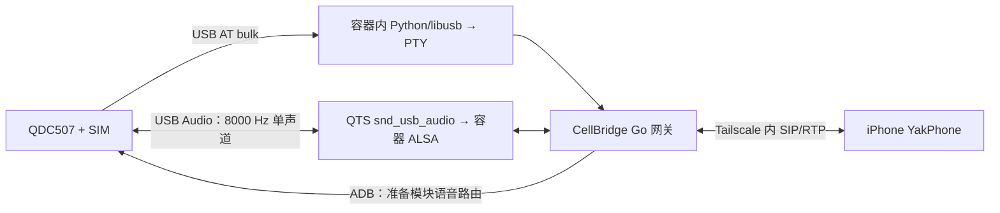

# CBD：QNAP 部署方案与实测记录

更新：2026-10-19。CBD 是 CellBridge-Docker，保留 CellBridge 上游历史。
上游基线见 [`UPSTREAM_COMMIT`](../../UPSTREAM_COMMIT)，参考 dontmove-kit
`666d22a45f3b8df29945132520aaafd922d395a7`。本文已结合用户提供的
QNAP + QDC507 + CellBridge + YakPhone 部署与开发指南，以当前源码及实测为准。
文中的 IP 地址和 Tailscale 主机名均为示例值，不是实际部署使用的地址。

**正式 Docker 网关已运行且 healthy；USB AT、ADB、UAC 空闲音频及 SIP 鉴权注册已通过。**
当前无需购买额外声卡，QDC507 自身的 USB Audio 已在 QTS 上识别并完成采集测试；
容器内的虚拟串口解决 AT 访问，虚拟声卡不能凭空接通模块的蜂窝音频。
用户已通过 YakPhone 接听一次真实来电，并确认双方声音清楚；接通后约 9.5 秒。
出站响铃时取消已由用户复测通过；短信接收与真实发送已开启，手机收发仍待实测确认。
出站接通、长通话、连续重拨和锁屏推送尚未完成验收。

## 用户约束：SIM 仅用于电话和短信

用户于 2026-10-01 明确要求：这张 SIM 只用于电话与短信，不使用它提供互联网接入。
后续部署、调试和验收必须遵守：镜像下载、软件更新、Tailscale 及应用联网均走 NAS 家庭网络；
不启动模块数据拨号、不把模块设为默认或备用上网出口，也不在家庭网络断开时切换到该 SIM。
保留现有通话所需的蜂窝注册与 IMS 配置；不为禁止上网而盲目关闭模块射频或更改 IMS。
模块重新枚举或 NAS 重启后，重新检查默认路由和模块数据接口，再执行需要互联网的操作。

本次只读复核：默认出口为 qvs1 → 192.168.1.1，模块 usb0 为 DOWN，RX/TX 均为 0。
随后用户明确授权开启短信收发，正式配置已改为 sms.inbox_enabled=true、
CELLBRIDGE_SMS_DRY_RUN=false；发送会真实提交运营商，按 SIM 套餐计费。
用户选择自行在手机测试，代理未代发短信。手机收发结果见下文短信验收记录。

## 方案与原指南的取舍

| 原指南 | 本次采用的方案及依据 |
|---|---|
| 无 ttyUSB 先解决 QTS 串口驱动 | 增加可选 usb-pty 传输；已通过真实 USB bulk / PTY / Go AT 探测，无需安装宿主串口驱动 |
| 初期使用 privileged 容器 | root + cap_drop ALL 已通过真实 AT、ADB 和两轮空闲 PCM 测试；正式 Compose 映射 USB/ALSA，无需 privileged |
| 运行上游 init-module.sh | 不直接运行：脚本会改 VID/PID。按下文保留 2ca3:4006，只开启 ADB/UAC |
| IMS 优先 1,1 | 接受有效的 0,1：MBN 默认配置、VoLTE 能力开启；这不代表 IMS 已注册 |
| 四份外部 runtime，包含 alsaucm | 当前实现只下载三份文件，使用模块固件自带 /usr/bin/alsaucm_test；已通过 ADB 核验 |
| SIP 监听 0.0.0.0 | SIP 与 RTP 都绑定实际 Tailscale 地址；HTTP 保持 127.0.0.1 |
| 尽量不改核心 | 保留 PCMU/8000、20ms RTP、capture 先启动、CLCC active 后采集、每通重建路由；修改集中于已发现的传输兼容和通话状态问题 |
| 按阶段验收，短信 dry-run，推送单独验收 | 初始化时禁用收件、发送保持 dry-run；用户授权后开启正式收发，推送单独验收 |

IMS 字段语义参见 Quectel [QCFG 手册第 7.6 节](https://quectel.com/content/uploads/2024/02/Quectel_EC2xEG2xEG9xEM05_Series_QCFG_AT_Commands_Manual_V1.0.pdf)。
QDC507 返回兼容格式；已据此修正 0,1 被误判为无语音控制能力的问题，没有修改模块 IMS 配置。



## 主机及模块实测

| 项目 | 结果 |
|---|---|
| NAS | QNAP，x86_64 |
| QTS / 内核 | 5.2.9.3499 / 5.10.60-qnap |
| Container Station | 3.0.7.891 |
| Docker / Compose | 20.10.27-qnap1 / 2.15.1-qnap1，overlay2 |
| Tailscale | 100.64.0.10；qnap-nas.example.ts.net |
| SSH | 用户已开启，普通用户公钥登录成功，可操作 Docker |
| USB | 物理端口 1-2，480 Mb/s，2ca3:4006，BAIWANG/Baiwang |
| AT 模型 / 固件 | QDC507 / QDC507GLEFM21 |
| SIM / 蜂窝注册 | CPIN READY / CEREG 0,1 |
| 信号 | 查询间 CSQ 20 和 17，Go 报告约 -79 dBm |
| IMS 配置 | `+QCFG: "ims",0,1`；实际 IMS 注册和通话待测 |
| Go 探测 | voice_control_only，SMS/voice/DTMF 能力为 true，requiresBootstrap=true |
| ADB / USB Audio | usbcfg 最后两位均为 1；ADB interface 6，音频 interface 7/8/9 |
| ADB 模块环境 | uid=0，内核 3.18.44，存在 /usr/bin/alsaucm_test |
| QTS 声音驱动 | snd_usb_audio 已识别 Baiwang USB Audio；当前 card 1，配置使用稳定卡名 |
| UAC 格式 | capture / playback 均为 S16_LE、单声道、8000 Hz |
| 宿主串口 | 无 ttyUSB/ttyACM；检查范围内无 option/usb_wwan/qcserial 模块 |
| 应用数据卷 | CBD 配置、数据库和语音组件放在 HDD 数据卷，不占系统 SSD |
| Docker 存储卷 | Docker 数据目录位于 HDD 数据卷 |

AT 接口为 interface 2，bulk OUT 0x03、IN 0x84，未绑定内核驱动。
其他接口不被抢占；ECM 的 cdc_ether 绑定保持原状。

### 已完成测试

| 检查 | 结果及范围 |
|---|---|
| 容器直接 USB 查询 | PASS；AT、型号、固件、SIM、注册、信号、usbcfg、ims |
| Go → PTY → USB → 真模块 | PASS；cellbridge-probe --usb-path 1-2 --timeout 30s --json，无 error/warnings |
| QNAP Linux PTY 自动化 | PASS，4 项；物理端口选择、错误端点拒绝、只读探测限制、断线丢弃命令及重连/退出 |
| Go 全量测试 | PASS，go test ./... |
| 竞态检查 | PASS，config、modem、SIP、voice 包 |
| Go vet / Linux amd64 编译 | PASS；gateway、admin、probe，测试工具链 Go 1.27.1 |
| Runtime 下载器 | PASS，4 项；三份本地文件 SHA-256 均通过 |
| QNAP Compose 解析 | PASS，真实 Compose 2.15.1 执行 config --quiet |
| 初始化脚本 | PASS，NAS Linux 6 项；MD5-crypt 独立向量、只读模式、备份与失败后不重试等 |
| 正式镜像构建 / 网关常驻 | PASS；1Panel 源拉取基础镜像，QNAP 构建 cellbridge-gateway:qnap，容器 healthy |
| ADB root / UAC / runtime | PASS；固件自带路由工具可用，固定哈希的 runtime 在模块 RAM 中加载 |
| 正式镜像空闲 PCM | PASS；两轮路由准备、启动、8000 样本采集及停止，播放端填充静音；未证明蜂窝通话有声 |
| SIP 鉴权 | PASS；Mac 经 Tailscale 到 NAS，无凭据 401、错误密码 401、正确注册 200、注销 200 |
| 容器停止 / 启动恢复 | PASS；完成音频测试后恢复 healthy，SIP 注册及错误密码复测通过 |
| YakPhone 前台注册 / 接听真实来电 | PASS；2026-10-01 15:08 北京时间，用户确认双方声音清楚 |
| 通话记录修复回归 | PASS；SIP 接通事件写入接通时间，终态 ended，迟到事件不重开历史；未接/失败呼出无虚假接通时间 |
| SIP 注册有效期 | 修复 Contact expires=300 被误记为 3600；支持只读查询，避免诊断覆盖手机注册 |
| 出站响铃时取消 | PASS；2026-10-01 部署修复后用户确认实际复测正常，呼出记录为 ended / local_hangup，无未结束记录 |
| 短信收发配置及自动化 | 已启用；中文短号 PDU、SIP 重传去重、接收持久化恢复、在线 MESSAGE 转发测试通过，手机收发待实测 |
| 出站接通 / 长通话 / 连续重拨 / YakPhone 锁屏 Push | 未通过验收，属于后续独立验收 |
| USB 热拔插 / 部署后的模块重启 / NAS 重启恢复 | 未执行；初始化时的模块重启和重新枚举已通过 |

临时诊断镜像 `cbd-usb-diagnostic:20261001` 已在 QNAP 构建成功。
因 Docker Hub 不可达，诊断构建复用 NAS 已缓存的 Debian 12 镜像层，
添加 Python 3.11.2、PyUSB 1.2.1、libusb 1.0.26 等工具；运行时覆盖入口，
关闭容器网络，只读根文件系统，并移除全部 capabilities。**它只用于诊断，不作为正式 CBD 镜像。**
完成正式镜像测试后，已定点删除诊断镜像、失败的构建容器和本次旧构建阶段，回收约 1.2 GiB。
正式 CBD 容器独立运行。
诊断文件和初始化原值备份保留在 `/share/CACHEDEV6_DATA/cbd-usb-test.Y5rU59`。

本次经用户明确授权，解锁 ADB、开启 UAC 并重启模块一次，没有刷写固件、修改 VID/PID 或安装 QTS 内核驱动。
代理没有主动拨号或发送/存储短信，也没有重启 NAS；用户自行进行了上述真实来电测试。
NAS 默认出口为 qvs1 → 192.168.1.1，
模块 usb0 保持 DOWN，最终检查 RX/TX 均为 0；镜像和软件包下载使用家庭网络。
这些主机侧计数不能替代运营商账单，但确认本次没有使用模块作为上网出口。

## AT 传输实现

[`gateway/tools/usb_at.py`](../../gateway/tools/usb_at.py) 参考 dontmove-kit 的 USB AT 接口选择，
由网关的 usbpty 子进程管理器启动。设置：

```yaml
modem:
  adapter: qdc507
  transport: usb-pty
  usb_path: 1-2
  tty: auto
  baud: 9600
  allow_usb_identity_changes: false
```

usb_path 是物理端口，不是会变化的 `/dev/bus/usb/001/002` 地址。
只接受指定端口上的已知 VID/PID，验证端点，不 detach 驱动、不 reset USB。
桥接进程退出会停止网关；USB 断线时暂停并以 1 秒间隔尝试重连同一物理端口，
丢弃离线命令，不自动重放可能已被接受的拨号/短信命令。此行为已有模拟断线测试，
真实拔插恢复仍待验收。更换物理插口时需要更新配置。

原生串口环境继续使用默认 transport: serial。QDC507 ADB 定位在 usb-pty 模式下
使用同一 usb_path，避免 /dev/pts/N 无 sysfs USB 拓扑的问题。
多个进程不能同时占用 AT 接口；探测前停止网关。

## 已完成的模块初始化及回退记录

用户指南 Milestone A 要求“不修改 SIM / QDC507，除非用户明确执行 init”。
用户随后明确授权开启并重启模块，本次已按以下流程完成。
[`gateway/tools/init_usb.py`](../../gateway/tools/init_usb.py) 默认为只读检查，
必须显式传入 `--apply --backup <新文件>` 才写入，不会由网关启动自动执行。
原值备份位于 NAS `cbd-usb-test.Y5rU59/init-state/original-usbcfg.json`，权限 600，不含解锁凭据。

1. 停止 AT 使用者；再次核验物理端口、型号、固件、当前 USB 配置和 QADBKEY 状态。
   只在型号及配置与本次一致时继续，保存本地受限权限的原始状态；不记录解锁凭据到 Git。
2. 使用 Debian 3.11 Python 的系统 libcrypt 计算已核实的 QADBKEY 应答，
   以独立 OpenSSL 向量验证后执行；不使用上游脚本的自制 MD5-crypt，不在错误或超时后重复写入。
3. 保留 VID/PID 及前五个 USB 功能位，仅把 ADB/UAC 两位从 0 改为 1：

   ```text
   原始：+QCFG: "usbcfg",0x2CA3,0x4006,1,1,1,1,1,0,0
   目标：AT+QCFG="usbcfg",0x2CA3,0x4006,1,1,1,1,1,1,1
   ```

4. 读回核验后执行一次 AT+CFUN=1,1，等待模块重新枚举；蜂窝服务短暂中断。
   不重启 NAS，不改变 IMS/运营商设置。响应超时先重新只读探测，不能当作写入失败重放。
5. 验证同一 USB 物理端口的 AT、ADB、id -u = 0、模块内核 3.18.44、
   /usr/bin/alsaucm_test 以及 QTS 的真实 USB Audio 采集/播放设备。
   模块内核版本与 QTS 内核不同，runtime 的 .ko 只能加载到模块里。
6. 若 AT 保持可用但新增功能失败，按保存的原值恢复：

   ```text
   AT+QCFG="usbcfg",0x2CA3,0x4006,1,1,1,1,1,0,0
   ```

   读回后重启模块。若 USB/AT 不再枚举，先断电重插并检查原端口；仍无法访问时，
   软件回退不可保证，停止继续写入，按模块厂商恢复步骤处理。不要修改 NAS 驱动碰运气。

上述检查已通过，正式配置已启用 voice/bootstrap 和 SIP，下一步是手机通话验收。

## 正式镜像、运行时和 Compose

镜像安装 ADB、ALSA、ffmpeg、USB 工具及 Python/PyUSB。
三份模块文件独立下载并校验，不打进镜像或提交 Git：

```sh
python3 scripts/fetch-voice-runtime.py
python3 scripts/fetch-voice-runtime.py --check
```

默认目录为被忽略的 artifacts/module-voice/。本机 NAS 部署目录采用组 0：
目录 750、.ko 文件 640、ARMv7 helper 750，确保容器的 UID/GID 0:0 可以访问；
cap_drop ALL 后，容器 root 不能越过文件权限，非 root 属主的 600 文件会读取失败。
data/ 为 770、组 0；目录不允许无关用户写入，文件哈希固定于脚本。
对应许可证及来源见 [第三方说明](../../ThirdParty/ThirdPartyNotices.md)。

本次在 QNAP 上使用用户指定的 1Panel 镜像源构建成功：

```sh
docker build --network host --platform linux/amd64 --build-arg TARGETARCH=amd64 \
  --build-arg GO_IMAGE=docker.1panel.live/library/golang:1.25-bookworm \
  --build-arg RUNTIME_IMAGE=docker.1panel.live/library/debian:bookworm-slim \
  --build-arg GOPROXY=https://goproxy.cn,direct \
  --build-arg DEBIAN_MIRROR=http://mirrors.tuna.tsinghua.edu.cn \
  -f gateway/Dockerfile -t cellbridge-gateway:qnap .
```

初次验收镜像 ID 为 `ce52cb7ae8d7`，约 615 MB；通话记录修复前的镜像保留为 `cellbridge-gateway:pre-history-20261001`。
通话记录修复镜像 `2574c5152774` 保留为 `cellbridge-gateway:pre-cancel-20261001`。
挂断修复镜像 `b69dc90c7314` 保留为 `cellbridge-gateway:pre-sms-20261001`。
短信镜像 `388445b18e3a` 保留为 `cellbridge-gateway:pre-audio-rearm-20261001`。
音频路由修复镜像 `d365cda2b0fe` 保留为 `cellbridge-gateway:pre-redial-20261001`。
当前连续拨号修复镜像为 `20bf40a2baef`，已于北京时间 2026-10-01 19:43 部署。
镜像源仅用于此构建，没有修改 QTS 的 Docker 全局配置。
Docker Hub 和默认 Debian 源较慢，替换基础镜像地址及 Debian 软件源后完成。
Debian 源配置参考 [TUNA 官方说明](https://mirrors.tuna.tsinghua.edu.cn/help/debian/)，保留 APT 签名校验。
若在另一台机器构建，可用 docker save / load 或 Container Station 导入镜像。

在有空间的共享目录创建私有 cbd/ 目录，包含 config.yaml、data/、module-voice/。
采用 [`infra/config.qnap.example.yaml`](../../infra/config.qnap.example.yaml)：

1. modem.usb_path 填实际端口 1-2。
2. voice.rx_path/tx_path 填实测的 hw:CARD=Baiwang,DEV=0，不能直接套 hw:0,0。
3. network.tailnet_hostname 填本机 MagicDNS，sip.listen 填 100.64.0.10:5060。
   HTTP 保持 127.0.0.1:8787，不添加公网端口转发。
4. 设备和 runtime 检查通过后，将 voice.enabled、voice.bootstrap、sip.enabled 改为 true，
   配置一个独立 SIP 用户和随机密码。NAS 配置采用组 0、权限 640，Mac 私有副本 600；不提交凭据和数据库。

[`infra/docker/docker-compose.qnap.yml`](../../infra/docker/docker-compose.qnap.yml) 是独立应用：
host 网络、UID 0、cap_drop ALL、no-new-privileges、USB/ALSA 映射、init 进程及日志限额。
ADB 使用容器内持久化 HOME 和回环 5038 端口，不终止主机的其他 ADB 服务。
当前权限已通过 AT/ADB/UAC 测试；后续失败先按错误定位，不直接扩大为 privileged。

```sh
cs_path=$(getcfg container-station Install_Path -f /etc/config/qpkg.conf)
export PATH="$cs_path/bin:$PATH"
cp infra/docker/.env.qnap.example infra/docker/.env
# 编辑 .env 的三个 NAS 绝对路径，预先创建目录及 config.yaml。
docker compose --env-file infra/docker/.env -f infra/docker/docker-compose.qnap.yml config --quiet
# 仅在以上设备初始化验收通过、正式镜像已导入后执行：
docker compose --env-file infra/docker/.env -f infra/docker/docker-compose.qnap.yml up -d --no-build
```

Container Station UI 可使用上述 Compose 渲染后的 YAML，移除 build 段并选已导入的镜像。
含路径/凭据的渲染配置留在本地。QNAP Compose 2.15.1 的 JSON 渲染结果需去除 null 字段后才能重新加载，
本次生成的部署文件已通过 config --quiet 验证。
模板默认 CELLBRIDGE_SMS_DRY_RUN=true，且 sms.inbox_enabled=false，供首次诊断使用；
本机正式部署已按用户授权改为 false / true，开启真实收发。
收件成功持久化后清理模块对应槽位；未完成的长短信分段也会先持久化，失败保留模块条目。
短信 dry-run 仍可能通过 AT+CMGW 存储草稿；本轮代理没有调用发送接口，连草稿也没有写入。
模块重新枚举后若 ALSA 设备节点变化，检查卡名并重建容器；真实热插拔尚未通过。

### 本机当前运行位置

NAS 应用目录 `/share/CACHEDEV6_DATA/cbd`，Compose 项目 `cbd`，容器 `cbd-gateway-1`。
可在 Container Station 查看容器与日志，也可以 SSH 管理：

```sh
cs_path=$(getcfg container-station Install_Path -f /etc/config/qpkg.conf)
"$cs_path/bin/docker" compose -p cbd -f /share/CACHEDEV6_DATA/cbd/compose.yaml ps
/sbin/curl -fsS http://127.0.0.1:8787/api/v1/health
```

SIP 为 `100.64.0.10:5060/UDP`，用户名 `iphone`；密码仅保存在私有配置。
Mac 的 `artifacts/qnap/deployment/yakphone-connection.txt` 包含手机完整接入参数，已被 Git 忽略。
ADB 仅监听回环 `127.0.0.1:5038`，HTTP 仅监听回环 `127.0.0.1:8787`。

### 首次真实通话后的修复

用户确认双向声音清楚后，核对数据库与日志发现：SIP 接通没有同步到记录模块、
完成状态一直为 ending，RING 事件没有补入 CLIP/CLCC 中的来电号码。已修复：

- SIP 音频接通后按物理通话 ID 同步状态；新增呼出开始事件，避免 SIP 呼出缺记录。
- 通话完成写入 ended，保留接通时间；迟到的状态写入、RING 和挂断事件不覆盖已结束记录或下一通电话。
- 处理 +CLIP，并在来电提示前进行最多 1.5 秒的只读 CLCC 号码查询；CLCC 仅匹配 mode=0 语音，忽略模块列出的空数据连接。
- 按 [RFC 3261 注册规则](https://www.rfc-editor.org/rfc/rfc3261#section-10.2.1.1) 优先使用 Contact expires；无 Contact 的 REGISTER 只查询现有绑定，不改变手机注册。
- 来电与结束事件按顺序处理，避免号码查询尚未完成时，挂断事件提前执行而留下虚假振铃。

已按同一通电话的 SIP 接通日志和 CLCC 语音号码，补齐首条记录；接通时间为北京时间
2026-10-01 15:08:35.579，结束时间 15:08:45.111，接通后时长 9532 ms。
修复同时生成同步序号及审计记录；没有录音内容可回放。
原数据库备份在 NAS `cbd/data/backups/before-call-history-repair-20261001T073836Z.sqlite`，完整性检查通过。
本机私有日志和修复依据保存在被 Git 忽略的 `artifacts/qnap/deployment/`。
更新前已确认没有未结束通话，宿主 UAC capture/playback 均为 closed；本轮只重建 CBD 容器，未重启模块。
更新后再次核对 ended、9532 ms、数据库完整性和 SIP 鉴权均正常。
无 Contact 的 SIP 绑定查询已通过真实 Tailscale 链路验证，错误密码 401、正确查询 200，且不替换手机绑定。
容器重建后手机已重新注册；后续真实取消/拒接复测结果见下节。

### 呼出响铃期间取消的修复

2026-10-01 15:49 的日志显示，手机已发送 CANCEL，但等待蜂窝接听的代码持有会话操作锁，
且未监听会话取消；挂断只能等接听等待结束后执行。期间另一条 INVITE 还被旧会话清理阻塞，
导致原呼叫结束后才意外开始下一次拨号。修复包括：

- CANCEL 立即收到 SIP 200，原 INVITE 收到 487；取消信号中断接听等待，释放挂断所需的锁。
- 一张 SIM 同时只接纳一通 SIP 会话，正在释放时的新呼叫返回 486，不排队拨号。
- 拨号准备阶段取消不会发送 ATD；ATD 已发出时保留该请求自己的物理通话 ID，再执行清理，避免遗留蜂窝呼叫或误挂其他通话。
- 使用模块支持的 AT+CHUP，明确不支持时才回退 ATH；查询 CLCC 确认语音呼叫消失后才记为已结束。
  挂断失败保留错误状态并记录日志，不把失败写成成功。

处置期间先停止网关，独立只读检查确认模块无语音呼叫；AT+CVHU? 为 0，AT+CHUP=? 返回 OK。
三条历史记录均已结束，本轮未修改历史记录、未主动拨号、未重启模块。
完整 Go 测试、SIP/modem/API 竞态测试及 go vet 通过；自动化覆盖等待接听时取消、准备路由时取消、
ATD 进行中取消、拒绝第二通会话，以及挂断返回 OK 但 CLCC 仍有通话时不能提前记为结束。

部署后容器 healthy、重启次数 0，数据库 quick_check 为 ok、未结束记录为 0，宿主 capture/playback 均 closed。
手机自动重新注册成功；只读 SIP 查询正确密码 200、错误密码 401，未改变手机绑定。
模块 usb0 仍 DOWN，RX/TX 均为 0。处置前日志保存在 NAS `cbd/data/before-hangup-fix.log`。
2026-10-01 用户随后确认本轮实际复测均正常，出站响铃时取消验收通过。
只读核对最新呼出记录：北京时间 16:07:19.861 开始，16:07:25.750 结束，
状态 ended、原因为 local_hangup、接通时间为空，符合未接通时主动取消；另两条来电记录也均已结束。
复测后未结束记录为 0，容器仍 healthy、重启次数 0，宿主 capture/playback 均 closed，未发现蜂窝挂断失败日志。
此结论覆盖本轮取消/未接清理，不扩大为长通话、锁屏推送或重启恢复验收通过。

### 短信收发启用

2026-10-01 16:22 部署后确认 sms.inbox_enabled=true、CELLBRIDGE_SMS_DRY_RUN=false。
收件每 5 秒轮询模块 MT 存储，只导入已读/未读的接收短信，保留草稿和已发送条目。
启用前独立查询得到 CPIN READY、CEREG 0,1，模块存储为空；没有读取到旧短信正文。
配置原值保存在 NAS 应用目录 `config.before-sms-20261001.yaml` 和 `compose.before-sms-20261001.yaml`；
数据库快照为 `data/backups/before-sms-enable-20261001T082044Z.sqlite`，
模块原始条目备份为 `data/backups/modem-sms-before-enable-20261001.json`。

本轮修复/接入：

- 所有号码（含运营商短号）使用 GSM7/UCS2 PDU；模式选择与发送持同一 AT 锁，收件查询的模式/存储选择也作为一个操作完成。
- 发送超时后用独立期限写入最终状态；SIP MESSAGE 事务在数据库持久化去重，同一请求重传或服务重启不再次提交短信。
- 接收消息和分段关联在同一事务提交；入库中途失败后可从已保存分段恢复，避免把分段存在误判为整条短信已完成。
- 使用 [RFC 3428 MESSAGE](https://www.rfc-editor.org/rfc/rfc3428) 向在线 SIP 客户端转发。
  未确认接收的消息保留在 NAS，客户端重新注册后重试；记录每个账号的成功确认，正文与电话号码不写入转发日志。
  SIP 2xx 仅表示客户端接受，不证明用户已读；若客户端收到后确认包丢失或持久化失败，客户端可能再次见到重试消息。

Go 全量测试、SIP/SMS/modem/db/API 竞态测试及 go vet 通过；无模拟测试会向运营商发送短信。
部署后容器 healthy、重启次数 0，短信轮询无报错，模块 usb0 DOWN、RX/TX 均 0。
用户选择自行用手机收发测试；开始测试时需 Tailscale 已连接、YakPhone 打开并注册。
锁屏推送仍未配置，不能以在线 MESSAGE 转发代替锁屏到达验收。
后续排查通话时已只读确认：6 条接收短信成功入库，日志有 YakPhone 的 SIP 接收确认；
数据库尚无发送记录，因此真实发送仍未通过验收。没有读取或展示短信正文。

### 取消后再次拨号无声的修复

用户报告振铃有声、接通无声。2026-10-01 18:03 的最近一次呼出：
手机 RTP 音频已到达网关，但模块 capture 连续 500 帧（约 10 秒）均为零。
其前一通在响铃阶段取消；模块路由仍属于前一通拨号准备，下一通准备直接复用了它。
代码缺陷是 Bridge.Stop 只清理已经 Start 的音频，没有释放仅执行 PrepareRoute 的情况。
没有发现同时段短信轮询错误；未通过关闭短信来掩盖问题。

修复内容：

- 会话记录自身的音频准备，取消、接听失败及未启动媒体桥时也释放准备资源。
- 每次新 PrepareRoute 强制建立新路由；只允许同一通电话的 Start 复用本次准备。
- Stop 在关闭宿主 capture/playback 后，按受控 PID 及进程启动时间停止模块路由。
- 蜂窝远端结束、来电超时或拒接时，先完成旧会话清理，再开放下一通，避免旧清理关闭新通话音频。
- 呼出日志打印实际 RTP 目标，避免将客户端 SDP 的公网地址误认为网关实际使用的地址。

全量 Go 测试、SIP/voice/modem/SMS 竞态检查及 go vet 通过。
QNAP 真机硬件测试（北京时间 19:10）通过：准备路由后不启动 PCM 即取消，确认 PID 文件已清理；
随后两轮均重新建立路由、采集 8000 个空闲 PCM 样本并停止，全程约 9.6 秒。
硬件测试没有拨号、发送短信或录制真实通话，不能替代接通后的双方语音复测。
排查前日志保存在 NAS `cbd/data/before-audio-rearm-20261001.log`。
短信收发保持开启，SIM 的互联网接入保持禁用。
修复部署后，用户确认首次拨号正常；19:23 的通话有手机 RTP 和非零模块 PCM，随后正常挂断。
用户随后报告重拨鉴权失败或忙线，处理记录见下节；连续多通的实际声音仍需复测。

### 重拨鉴权与无确认通话清理

2026-10-01 19:24 的第二次呼出已在蜂窝侧接通，但没有收到手机 RTP、BYE 或 CANCEL，
之后的新拨号因单卡线路被占用而返回忙线。旧版没有处理呼出 200 OK 的 ACK，
也没有等待 ACK 的超时清理，因此不能从旧日志断言是否收到 ACK 或具体哪一包丢失。
暂停网关后已直接查询模块 CLCC，确认无活动通话；宿主两路 PCM 均 closed。
现场日志保存在 NAS `cbd/data/before-sip-redial-fix-20261001.log`。

发现并修复以下协议问题：

- 原鉴权只保留同一 cnonce 的最新计数，REGISTER 与 INVITE 交错时可能拒绝合法重传。
  现保留有限计数窗口，允许原始报文重传及乱序，拒绝修改报文复用计数。
- 每次鉴权挑战使用新 nonce，同时保留未过期挑战，避免连续通话或注册相互干扰。
  密码证明正确但 nonce/计数已失效时返回新挑战及 stale=true，客户端可使用原密码重试；
  错误密码仍拒绝，且不会被标记为过期凭据。状态容量及生命周期均有上限。
- 呼出接通后重复发送同一 200 OK，收到匹配 Call-ID、标签、CSeq 和来源 IP 的 ACK 才停止。
  按 [RFC 3261 §13.3.1.4](https://datatracker.ietf.org/doc/html/rfc3261#section-13.3.1.4)
  从 500 ms 退避至 4 s，32 s 未确认即发送 BYE 并释放蜂窝腿和媒体资源。
- 最终 INVITE 响应短期缓存绑定原始报文和来源，挂断后迟到的旧请求不会再次拨号。
- 本次停止服务还暴露 USB AT helper 先于 SIP 挂断退出的问题；现保留其运行直到
  SIP 和串口清理完成，再由 defer 关闭 helper，避免 SIGTERM 先切断挂断所需的控制通道。

该次残留通话的历史记录已在备份后单独校正，并写入同步及审计记录。
备份为 NAS `cbd/data/before-redial-history-repair-20261001.sqlite`。
由于没有观测到精确的蜂窝结束时间，`ended_at` 明确记录恢复时间，
结束原因是 `recovered_no_active_call_verified`，不能将其时长当作准确计费时长。

自动化覆盖：注册/拨号交错重传、乱序、nonce 过期及服务重启后的凭据刷新、错误密码拒绝、
200 OK 丢包重传、错误 ACK 忽略、无 ACK 自动挂断，以及连续两次完整鉴权→接通→ACK→BYE→立即重拨。
后者使用模拟模块，包含旧 INVITE 在挂断后迟到的场景，不拨打真实号码或发送短信。
全量 Go 测试、SIP/voice/modem/SMS 竞态检查及 go vet 已通过。
鉴权报文的历史日志未保存失败原因，因此上述鉴权缺陷是代码和回归复现结论，
不能把此次手机提示的每一次失败都归为已抓包证明的同一原因。

19:43 部署后健康接口正常。Mac 经 Tailscale 对运行中的网关做了仅查询 REGISTER 的验证：
独立挑战、交错重传、计数乱序、计数重置后的新挑战、过期 nonce 自动刷新均通过，错误密码仍返回 401。
验证不携带 Contact，不修改手机注册，也没有拨打真实电话或发送短信。
NAS 默认路由仍为家庭网关 `192.168.1.1`，模块 `usb0` 为 DOWN，收发计数均为 0。
此时手机尚未重新注册；已请用户打开 YakPhone 后复测两次真实拨号、双向声音及挂断。

### 上行语音延迟与静音插帧

用户确认 Linphone、YakPhone 均能通话，但手机发言在对端延迟约 1–3 秒且音质差，
接听对端语音相对正常。2026-10-01 20:30 起排查发现：

- 原 ALSA 播放环为 8192 样本，8kHz 下约 1024ms；[aplay 1.2.8](https://github.com/alsa-project/alsa-utils/blob/v1.2.8/aplay/aplay.c)
  默认填满环后启动，
  配合 1024 样本的 128ms 传输周期，会明显增加上行等待。
- bridge 已按 20ms 节拍写入语音或补充静音，ALSA 的 primeLoop 又按独立节拍、
  “距上次写入超过 15ms”的条件写静音。自动化用旧实现复现了语音帧之间插入零帧。
- 上层队列最多保存 50 帧（1 秒），没有按帧年龄淘汰；声卡阻塞时还会持有 RTP 回调需要的锁。

修复：ALSA 采用 160 样本（20ms）周期、640 样本（80ms）环，播放启动阈值 40ms；
primeLoop 只负责启动预填充，第一次 WritePCM 后将写入节奏完全交给 bridge。
上层保留短抖动缓冲，最多 6 帧（120ms），溢出恢复至 3 帧并丢弃超过 120ms 的旧帧。
声卡写入不再占用 RTP 回调锁，Stop 可以关闭设备以中断阻塞写；旧写入退出后才能让下一通接管。
日志新增 queue_ms、queue_peak_ms、dropped、underruns，并保留 ALSA 工具的 XRUN 诊断。

Go 全量测试、voice/SIP/modem 竞态测试及 go vet 通过。回归覆盖重复静音、突发积压、
过期帧、缺帧恢复，以及声卡阻塞时继续接收 RTP 和及时挂断。
QNAP 硬件验证于 20:37 通过：两轮独立路由均采集 8000 个空闲样本；
随后用生产 bridge 和合成 PCM 连续运行 10 秒，收到 499 帧采集数据，播放内核延迟 21–41ms，
上层队列在日志采样时为 20–40ms、峰值 60ms，dropped=0、underruns=0，无 ALSA XRUN 日志。
硬件实际参数确认为双向 S16_LE、mono、8000Hz、period_size=160、buffer_size=640。
测试结束两路 PCM 均 closed，旧服务自动恢复；期间不拨号、不发短信，SIM 的 usb0 仍保持关闭。

20:39:45 已部署镜像 `499a9c7619e0`，容器 healthy、重启计数 0，数据库 quick_check=ok，
未结束通话为 0。只读 SIP 验证正确密码 200、错误密码 401，未修改客户端绑定。
旧日志保存在 NAS `cbd/data/before-uplink-latency-20261001.log`；SIM usb0 为 DOWN、RX/TX 均为 0。

以上延迟只反映网关声卡和应用缓冲，不是手机到对方的全程测量。
部署后用户通过真实通话确认延迟已明显改善。对端音质及超过 60 秒连续交谈的稳定性
尚未获得单独确认，保留为后续验收项。
回滚镜像保留为 `cellbridge-gateway:pre-uplink-latency-20261001`。

## 保留的语音逻辑与后续验收

已接入 dontmove-kit 的 Contact/ACK/RTP 地址处理、CLCC 来电方向判定、
会话领取及重复事件防护、远端挂断同步、API/SIP 事件分发，并补充 Linux 回归测试。
修复活跃通话被振铃计时器结束，以及短通话后旧路由被复用的问题。
保留每通准备路由、CLCC active 后 capture → playback、PCMU/8000、20ms pacing。
没有引入参考项目的 macOS Swift 音频 helper 或 Linphone 推送。

修复原有仅检查 Authorization 头存在的占位鉴权。REGISTER、INVITE 和 MESSAGE
现校验 SIP Digest MD5/qop=auth、实际方法与 URI、短期随机 nonce 和计数，限制重放并允许原始 UDP 请求重传。
已完成 RFC 独立向量、错误凭据及未授权拨号/短信请求被拦截的自动化测试；YakPhone 前台注册已实测通过。

按以下顺序验收，每项保留结果，失败时停在该层定位：

1. 已完成：ADB root、固件 ABI、runtime、UAC 空闲 PCM、容器健康及合成 SIP 客户端注册；HTTP health 仅证明进程活着。
2. YakPhone 前台注册及一次真实来电双向声音已通过；仍需分别检查 Wi-Fi 和移动网络，PCMU 优先，STUN/TURN 关闭。
3. 短信接收和真实发送已按用户要求开启；由用户用手机收信和回复，核对数据库、SIP 接收确认及对方实际收到的结果。
4. 出站响铃时取消及本轮未接清理已复测通过；用户指定目标后继续验证出站接通声音及接通后双方挂断。
   至少一通超过 60 秒，连续五通包含立即重拨，检查第二通静音和活跃会话残留。
5. 独立验收 YakPhone 锁屏唤醒。其 [App Store 官方介绍](https://apps.apple.com/cn/app/yak-ai-sip-%E7%94%B5%E8%AF%9D/id6763033863)
   提及 HMAC-SHA256 推送认证；尚未取得具体签名协议，不猜字段、不预先实现 HMAC。
   HTTP 200 与手机锁屏真实振铃需同时通过，旧 token-only 接口不能视为已兼容。
   用户已开启 Tailscale VPN On Demand，并确认手机的后台唤醒入口提示需要 YakPhone Pro。
   下一步先由用户恢复购买或自行选择开通权益，取得应用实际提供的推送配置及接入说明后再配置网关。
   本轮没有购买、启用推送、写入占位 token 或重启现有通话服务。
6. 容器停止/启动恢复已通过；USB 拔插、部署后的模块重启及 NAS 整机重启仍需逐项验证自动恢复。

目前不能把这套系统视为已经可承接主号的生产网关。

## 复现开发侧检查

```sh
cd gateway
go test ./...
go test -race ./internal/config ./internal/modem/... ./internal/sip ./internal/voice/...
go vet ./...
CGO_ENABLED=0 GOOS=linux GOARCH=amd64 go build -o ../artifacts/qnap/ \
  ./cmd/cellbridge-gateway ./cmd/cellbridge-admin ./cmd/cellbridge-probe
cd ..
PYTHONDONTWRITEBYTECODE=1 python3 -m unittest discover -s gateway/tools -p 'test_*.py'
PYTHONDONTWRITEBYTECODE=1 python3 -m unittest discover -s scripts -p 'test_fetch_voice_runtime.py'
sh -n scripts/qnap-preflight.sh
```

### YakPhone 注册地址、挂机重试与 Pro 推送（2026-10-03）

本次故障日志显示，YakPhone 的 Contact 曾包含 `198.18.0.1`，实际 SIP 请求则从
Tailscale 地址到达。网关现在保留原始 Contact，同时将鉴权后的 REGISTER 来源作为
INVITE、MESSAGE 和后续挂断消息的 UDP 目的地；旧传输的注销不会删除新传输的绑定。
来电期间，同地址重新注册也会收到相同事务的 INVITE，覆盖 PushKit 唤醒后重建 SIP 栈的情况。

另一次呼出 CANCEL 已到达网关，但模块对 CHUP 返回成功后，CLCC 仍报告语音呼叫。
现在仅在 CLCC 确认原通话仍存在时，依次有限重试 ATH、CHUP、ATH；始终查询 CLCC 验证，
不把命令返回 OK 当成电话已断开。命令响应超时不盲目追加指令。
真正的 NO CARRIER 会清理对应物理通话的失败会话，释放下一通电话的入口；不会误挂新通话。

YakPhone Pro Token 上报接入：

1. 在 `sip` 下配置 `push_callback_listen: 127.0.0.1:8788`，保持控制 API 仅监听回环地址。
2. 首次启动生成 `data/yakphone-push.json`（权限 0600），保存独立随机 `callback_key` 和
   最新 `voip_token`。原 `sip.push_token` 可用于首次迁移；已有持久 Token 优先。
3. 通过私网 Tailscale Serve 将 HTTPS 端口转发到 `http://127.0.0.1:8788`。
   QNAP 上已安装的 Tailscale 1.40 用法：
   `tailscale serve https:8443 / http://127.0.0.1:8788`。不启用 Funnel。
4. YakPhone 的 Token 回调 URL 填
   `https://qnap-nas.example.ts.net:8443/token/<callback_key>`，保存并发送当前 Token。
   请求是 `POST application/json`，正文 `{"voip_token":"<设备 Token>"}`。
   回调凭据只放在本机私有部署文件，不提交 Git；服务日志不输出 URL 密钥或 Token。
5. 收到回调后立即原子保存并用于电话/短信推送，不需要重启。来电推送异步执行，
   结束通话会取消尚未完成的 HTTP 请求，避免中继延迟阻塞挂机。

推送使用现有 Yak 官方 `/v1/notify` 协议，检查 HTTP 和 JSON 错误；401/403 等不会再记成
“已发送”。如果实际接口要求新的 HMAC 参数，必须以当前 App/官方接入说明为准，不能猜测密钥。
HTTPS Token 上报成功仅表示服务器保存了 Token，仍需用真实来电验证 Pro 授权、锁屏唤醒、
重新注册和接听；推送中继接受请求也不等于手机已经响铃。
手机接听仍须能通过 Tailscale 连接 NAS。自动测试使用模拟 HTTP/AT/UDP，不拨号、不发送真实短信。

本轮部署镜像为 `aae510ad2791`；回退镜像为 `cellbridge-gateway:pre-yak-fix-20261003`，
配置备份为 NAS `config.before-yak-fix-20261003.yaml`。完整 Go 测试、SIP/AT/API/Yak 推送的
竞态测试及 `go vet ./...` 均通过。2026-10-03 23:26（北京时间）重建后容器 healthy、重启次数 0。
NAS 已启用仅 tailnet 可访问的 HTTPS 8443 → 回环 8788，证书验证通过；手机于 23:30 起自动
上报 Token，回调返回 200，凭据文件权限 0600。官方 `type=missed` 测试及真实来电的
`type=voip` 均返回 200；用 Python 默认 UA 的首个诊断请求被 Cloudflare 1010 拒绝，
使用实际网关的 Go HTTP UA 成功，生产代码无需模仿浏览器或额外签名。

23:29 来电已获手机 180，远端结束后两次 CANCEL 均获手机 200。
23:31 呼出取消时触发 ATH 重试，约 1 秒内确认 `local_hangup`。
用户确认呼入、呼出响铃时取消、接通后挂机均正常；锁屏后台唤醒另行验收，不与前台通话混同。

随后锁屏接听测试暴露了重复提示：同一来电先得到 YakPhone 的 180，随后无条件发出的
VoIP 推送又触发注册/系统来电，点击接听时 YakPhone 返回 486，模块按拒接挂断。
第二次修复为先给 SIP 1.5 秒振铃窗口：当前 INVITE 的目标客户端已返回 180/183 时跳过
冗余推送；只有未振铃且仍存活的来电才走 PushKit。100 Trying 不会抑制推送，无关来源的
响应也不会抑制推送。全量测试、SIP 竞态检查及静态检查再次通过。

去重版本镜像为 `286fc99b0391`，保留上一版 `cellbridge-gateway:pre-push-dedup-20261003`
以便对照；最初的通话/音频稳定版本仍保留在 `pre-yak-fix-20261003`。
第二次更新前确认无未结束通话、ALSA 双向 closed，更新后仅重建 CBD 容器。

最终锁屏验收通过：23:38:21 收到来电时没有可达注册，23:38:24 官方接受 VoIP 推送，
23:38:25 手机重新注册并返回 180，23:38:33.087 确认接通，23:39:16.796 以
`local_hangup` 正常结束，接通时长 43709 ms。用户明确确认锁屏能接通、双方通话和挂机均正常。
该次实际覆盖“推送唤醒 → 重新注册 → SIP 接听 → 模块接听 → 双向音频 → 挂断”，
并非仅凭 HTTP 200 判断成功。验收后数据库完整性 ok、未结束通话为 0、ALSA 双向 closed，
容器 healthy 且重启次数 0；QNAP 的 usb0 仍为 DOWN、RX/TX 均为 0。
当前 Token 已通过手机 HTTPS 回调上报并持久化；不同 Token 的轮换由自动测试验证。私有日志保存在 NAS
`data/after-yak-fix-20261003.log`。长时间休眠、多日 Token 轮换及 NAS 断电恢复尚未作为本轮验收项目。

### 代理改写音频端口后的回程无声（2026-10-07）

当天 11:30、11:31 的两次呼出均已接通。日志显示模块持续采集非零 PCM，手机的 RTP
也到达网关；回程却固定使用 SIP 来源 IP 加 SDP 上报端口（分别为 22324、20116）。
这不能单凭日志证明实际映射端口不同，但代码确实没有处理 UDP 代理/NAT 改写源端口。
手机使用 Surge 内置 Tailscale 时，该缺口可导致信令、短信正常而回程音频丢失。

修复在相同 SIP 对端 IP 内学习实际音频端口：连续 3 个 RTP v2、PCMU/PT=0、160 字节、
相同 SSRC 且序号连续的包确认后，更新发送目标。端口映射再次变化时重新确认；非法包、
其他地址、其他编码和单个杂散包不能改变回程目标。每个会话独立保存目标，新的 SDP
设置会重置学习状态。保留原有声卡参数、队列延迟和每通重建模块音频路由的处理。
相关背景见 [RFC 4961](https://www.rfc-editor.org/rfc/rfc4961.html)。

隔离测试已在原版本复现“仍发送到 SDP 端口”的失败；新测试还覆盖实际 UDP 回传、
来源限制、包格式/编码过滤、重复及跳号、端口重新映射和序号回绕。

NAS 隔离容器中 `go test -race ./internal/sip`、`go test ./...` 和 `go vet ./...`
均通过。测试容器需挂载仓库根目录（配置测试会读取 `infra/`），且使用 bridge 网络
提供非回环网卡；仅挂载 gateway 或使用 network none 会分别导致现有配置/本机地址测试失败。

2026-10-07 23:51（北京时间）部署镜像 `905f30531e65`，更新前确认没有通话、ALSA
双向 closed；回退镜像为 `cellbridge-gateway:pre-rtp-return-20261007`。更新后健康接口
返回 ok，容器 healthy 且重启次数为 0，数据库 quick_check 为 ok、无未结束通话，短信轮询已启动，usb0 保持 DOWN，
RX/TX 均为 0。本次没有自动拨号或发送短信。

23:52 用户发起的呼出已在现场确认端口改写：SIP 会话 `068e981049724f85` 的原回程
目标为 `100.64.0.21:5532`，实际 RTP 来源为 `100.64.0.21:38616`；23:52:48
网关成功学习新目标。双向均有非零音频帧，23:52:59 以 local_hangup 结束。
这证实现场存在旧版无法处理的映射差异。用户随后明确反馈“两次都能正常双向通话”。
服务器本轮可对应到上述一次新通话，不能将用户报告的两次均记为已逐通匹配日志。
收尾检查确认未结束通话为 0、ALSA 双向 closed、数据库完整性 ok，容器 healthy 且
重启次数 0；usb0 仍为 DOWN、RX/TX 均为 0。

### 短信只保留正文预览通知（2026-10-19）

用户确认重复提醒的外观不同：第一次是 YakPhone 的“有短信＋号码”，第二次才带正文预览，
并明确选择只保留第二种。网关原先在短信入库后立即调用 Yak 中继 `type=message`，
另一个独立流程再用 SIP MESSAGE 投递正文；两条路径先后触发手机通知。

本次移除 API 收信回调中的 Yak 短信推送，只通过现有 SIP MESSAGE 传递短信正文。
来电 PushKit、Token 回调、短信入库及 SIP 接收回执保留；不把推送中继的 HTTP 200
记作手机已接收正文。手机离线或休眠且 SIP 不可达时，短信保存在 NAS，等 YakPhone
恢复连接后补收，因此此模式不提供独立的离线短信推送唤醒。

Go 全量测试、API/SIP/SMS/DB/Yak 推送竞态检查及 `go vet ./...` 通过；新增回归测试
验证收信不会触发额外 Yak 推送，同时仍发布完整中文短信同步事件。既有 SIP 测试覆盖
完整 UTF-8 正文、同事务重传及手机接收确认。未发送测试运营商短信。

修复于北京时间 12:56 部署，镜像 `f62f610467ac`，回退镜像
`cellbridge-gateway:pre-sms-preview-20261019T045254Z`。数据库快照为 NAS
`cbd/data/backups/before-sms-preview-20261019T045254Z.sqlite`；部署文件、原配置及日志
保存在 `cbd/deployments/sms-preview-20261019T045254Z/`，其中私有文件不提交 Git。
新镜像复用原运行环境，只替换通过 SHA-256 核对的网关二进制。

部署后容器 healthy、重启次数 0，数据库 quick_check 为 ok，67 条接收短信及 67 条
SIP 接收回执完整，配置未改动。只读 SIP 验证为无凭据 401、错误密码 401、正确绑定
查询 200，手机已注册且查询没有替换绑定。启动日志明确记录
`transport=sip-message generic_push=false`。手机通知外观尚待用户下一次实际收信确认。
